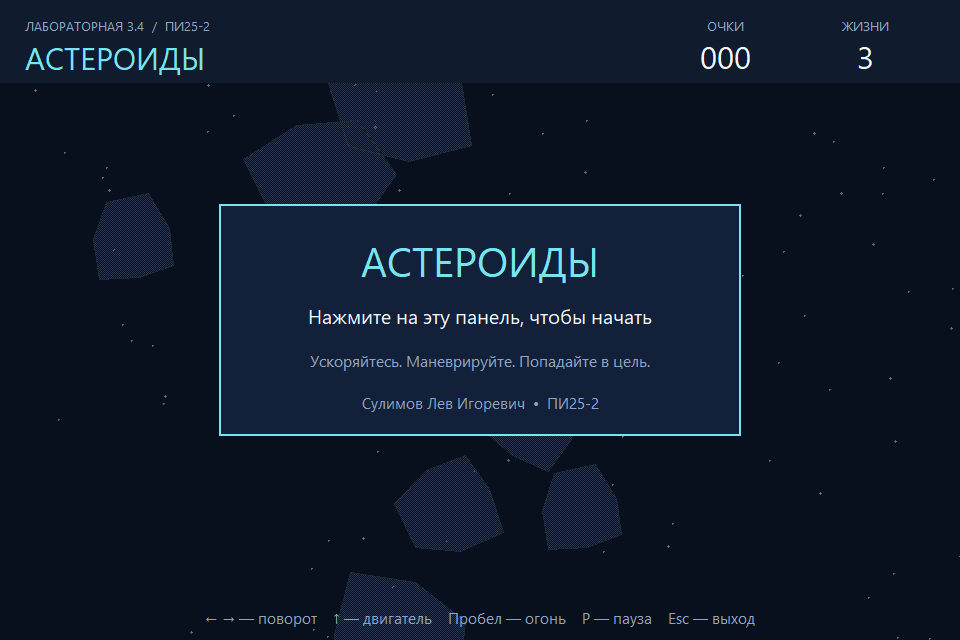
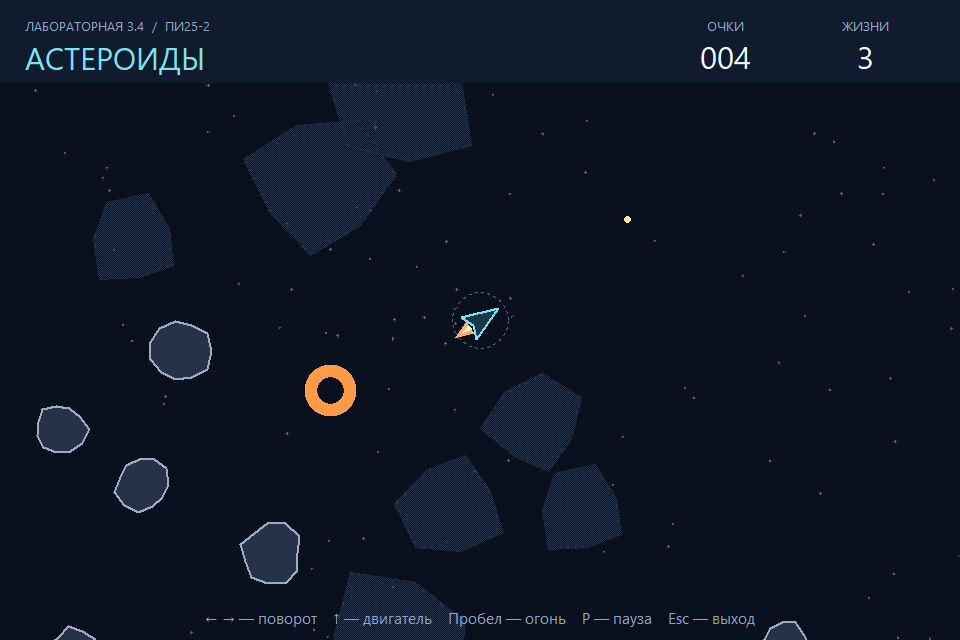

# Лабораторная работа 3.4 — Астероиды

**Автор:** Сулимов Лев Игоревич  
**Группа:** ПИ25-2  
**Дисциплина:** Практикум по программированию  
**Дата подготовки:** 24.11.2026  
**Дата сдачи:** 25.11.2026

## Описание проекта

Двумерная аркада на Python и tkinter с управляемым космическим кораблём.
Игрок ускоряется, поворачивает корабль и уничтожает астероиды ракетами;
игровое поле замкнуто по обеим координатам.

## Проектирование

`Body` задаёт общую кинематику; `Ship`, `Asteroid` и `Missile` наследуют её.
`Game` управляет столкновениями и состоянием партии, `Explosion` задаёт
время жизни взрыва, `App` обрабатывает события и рисует кадры.
Программа разделена на четыре модуля: `main.py`, `config.py`,
`models.py`, `view.py`. Отдельные тесты проверяют игровую математику.

## Функциональные возможности

### Основной функционал

- Начальная заставка, 3 жизни и 0 очков; запуск только щелчком по заставке.
- Неподвижные звёзды и полупрозрачный слой астероидов, движущийся влево.
- Поворот, ускорение, инерционное движение и торможение до полной остановки.
- Изменение изображения корабля при включении двигателя.
- Тороидальное поле для корабля, ракет и астероидов.
- Случайные положение, линейная и угловая скорости астероидов.
- Ракеты из носа корабля, постоянная скорость и ограниченное время жизни.
- Одно очко за уничтоженный астероид, тайловая анимация взрыва.
- Возрождение неподвижного корабля в центре при столкновении.
- Заставка после завершения партии с сохранением счёта и жизней.

### Дополнительный функционал

- Защита на 1,8 секунды после появления корабля.
- Пауза и автоматическая остановка игры при потере фокуса.
- Ограничения максимальной скорости, частоты стрельбы и числа астероидов.
- Физические подшаги до 1/120 секунды для устойчивой проверки столкновений.
- Отображение копий объектов у границ, включая углы поля.

## Демонстрация работы программы

### Начальное окно



### Игровой процесс



Скриншоты получены из реального Canvas. Вторая сцена показывает заданное
демонстрационное состояние: двигатель, ракету, астероиды и кадр взрыва.

## Требования к системе

- Python 3.10 или выше; проверено на Python 3.14.7, Windows, Tk 9.0.4.
- Windows / macOS / Linux с графическим рабочим столом.
- Стандартные модули: `tkinter`, `dataclasses`, `math`, `random`, `time`,
  `os`, `pathlib`, `sys`, `zipfile`; тесты используют `unittest`, `types`.
- Сторонних Python-пакетов нет. Это указано в `requirements.txt`.
- В Linux при необходимости устанавливается системный пакет `python3-tk`;
  в Windows должен быть установлен компонент Tcl/Tk Python.

## Установка и запуск

### 1. Клонирование

Откройте терминал и выполните:

```bash
git clone https://github.com/levsulimov/lab-3-4-asteroids.git
cd lab-3-4-asteroids
```

Если проект уже находится на компьютере, просто откройте терминал в папке.

### 2. Виртуальное окружение

В соответствии с техническим заданием настоящее `venv/` включено в Git,
а не в `.gitignore`. Оно создано для компьютера автора и содержит локальные
пути. На другом компьютере пересоздайте его.

Windows, Git Bash:

```bash
py -3 -m venv venv
source venv/Scripts/activate
```

Windows, PowerShell без обязательной активации:

```powershell
py -3 -m venv venv
.\venv\Scripts\python.exe -m pip install -r requirements.txt
.\venv\Scripts\python.exe main.py
```

macOS / Linux:

```bash
python3 -m venv --clear venv
source venv/bin/activate
```

Если Python автоматически создал `venv/.gitignore` с правилом `*`,
удалите только этот файл, чтобы окружение оставалось доступным в Git
согласно требованиям преподавателя. Кэш Python исключён корневым файлом.

### 3. Зависимости

В активированном окружении:

```bash
python -m pip install -r requirements.txt
```

Сторонних зависимостей нет, поэтому скачивать пакеты не требуется.

### 4. Запуск игры

```bash
python main.py
```

В подготовленной Windows-папке доступен также `start.cmd`.
Для Windows-сборок Python с Tcl/Tk в ZIP функция `prepare_tk()` в `main.py`
распаковывает библиотеки установленного Python в `venv/tcl-runtime/`.
Переменные путей действуют только в процессе игры.

### 5. Управление

| Действие | Результат |
| --- | --- |
| Щелчок по центральной заставке | Начать новую партию |
| Стрелки влево / вправо | Повернуть корабль |
| Стрелка вверх | Включить двигатель |
| Пробел, в том числе удержание | Выпускать ракеты |
| P в английской раскладке | Пауза / продолжение |
| Esc | Закрыть окно |

Щелчок вне заставки и клавиша Enter не запускают игру.

## Структура проекта

```text
lab-3-4-asteroids/
├── .gitattributes
├── .gitignore
├── README.md
├── requirements.txt
├── main.py
├── config.py
├── models.py
├── view.py
├── start.cmd
├── screenshots/
│   ├── menu.png
│   └── gameplay.png
├── tests/
│   ├── test_model.py
│   └── test_ui.py
└── venv/
```

| Модуль | Назначение |
| --- | --- |
| `main.py` | Подготовка Tcl/Tk, создание окна |
| `config.py` | Все игровые параметры |
| `models.py` | Объекты, кинематика, генерация, столкновения и состояние игры |
| `view.py` | Canvas, графика, тайлы, события и цикл анимации |
| `tests/` | Проверки физики, правил и взаимодействия с окном |

Основная программа состоит из четырёх файлов, как рекомендовано заданием.
Объектная модель независима от интерфейса и тестируется без создания окна.

## Алгоритмы и обоснование решений

### Иерархия классов

```text
Body
├── Ship       — двигатель, поворот, сопротивление, защита
├── Asteroid   — случайные скорости и неровный контур
└── Missile    — постоянная скорость, ограниченное время жизни
Explosion     — положение, возраст и индекс тайла
Game          — коллекции объектов, счёт, жизни, правила
App           — окно и связь событий с моделью
```

### Движение и столкновения

Положение обновляется по формулам `x = (x + vx * dt) % WIDTH` и
`y = (y + vy * dt) % HEIGHT`. Скорости на границе не меняются.
Расстояние на торе использует `min(abs(dx), WIDTH - abs(dx))` и аналогичную
вертикальную компоненту: столкновения корректны даже через швы поля.
Форма столкновения — окружность, а визуальный контур астероида — многоугольник.
Астероиды проходят друг через друга; взаимодействие между ними не вычисляется.

Ускорение направлено вдоль `(cos(angle), sin(angle))`. При выключенном
двигателе скорости умножаются на `exp(-DRAG * dt)`, а при скорости ниже
2 px/s обнуляются. Такое торможение зависит от времени, а не числа кадров.
Максимальная скорость корабля — 350 px/s.

### Ракеты

Ракета возникает на 22 пикселя впереди центра корабля. Её мировая скорость
равна 520 px/s, скорость корабля не добавляется. Время жизни — 0,9 s:
`520 × 0,9 = 468 px < min(960, 640) = 640 px`. Поэтому ракета не может
пролететь всё поле даже по меньшему измерению. Одна ракета уничтожает
ровно один астероид и приносит одно очко. Истёкшие ракеты удаляются.

### Жизни и завершение

Буквально выполнена формулировка задания: если **до столкновения** уже
было 0 жизней, партия заканчивается. Последовательность:
`3 → 2 → 1 → 0 → конец при следующем ударе`.
После первых трёх ударов корабль появляется неподвижным в центре.
Защита 1,8 s предотвращает повторную потерю жизни сразу после возрождения.
После конца игровые объекты скрываются, счёт и 0 жизней остаются в HUD.
Следующий щелчок по заставке сбрасывает счёт и возвращает 3 жизни.

### Графика и тайловая анимация

Графика создана самостоятельно средствами tkinter. Звёзды неподвижны;
фоновый слой сдвигается влево на 16 px/s и замыкается по горизонтали.
Полупрозрачность фоновых полигонов реализована через `stipple="gray50"`:
половина пикселей пропускает фон, это растровая имитация прозрачности.
Изображение корабля при ускорении дополняется двумя полигонами пламени.

Для взрыва при запуске создаётся настоящий спрайт-лист `PhotoImage`
размером 960 × 80: 12 тайлов 80 × 80 с прозрачным фоном. Тайлы вырезаются
операцией `copy -from`. За 0,48 s индекс кадра меняется по возрасту взрыва,
после чего анимация удаляется. Сторонние изображения и лицензии не нужны.

Физика обновляется подшагами не более 1/120 s. Перерыв более 0,1 s не
догоняется целиком, чтобы после задержки окна объекты не телепортировались.
Рисование назначается через `after` с целевой частотой около 60 кадров/s.
Проверка столкновений имеет сложность O(A × M + A), где A — количество
астероидов, M — количество ракет; лимиты объектов делают её достаточной.

## Пример использования

1. Запустите `python main.py`: видны заставка, 3 жизни и 0 очков.
2. Щёлкните по центральной панели — корабль появится в центре.
3. Удерживайте ↑ для разгона, затем отпустите: корабль постепенно остановится.
4. Поверните корабль стрелками и нажмите пробел, чтобы выстрелить.
5. При попадании виден взрыв, счёт увеличивается на 1.
6. После окончания партии щёлкните по заставке для новой игры.

## Проверка работы

Только модель, графический сеанс не требуется:

```bash
python -m unittest discover -s tests -p test_model.py -v
```

Полная проверка, для неё нужен рабочий tkinter и графический сеанс:

```bash
python -m unittest discover -s tests -v
```

Проверено 24.11.2026: **17 тестов пройдено** (14 модели и 3 интерфейса).
Проверяются границы тора, столкновения в углах, торможение, двигатель,
дальность и истечение ракет, счёт, жизни, защита, генерация, перезапуск,
тайлы взрыва, область запуска и отпускание клавиш.

## Контроль версий и соответствие требованиям

Первый коммит содержит только `README.md`, сообщение:
`Сулимов Лев Игоревич`. Последующие коммиты отдельно добавляют модель,
окно, проверки и документацию. История: `git log --oneline --reverse`.
Работа выполнена индивидуально. Параметры вынесены в `config.py`.
